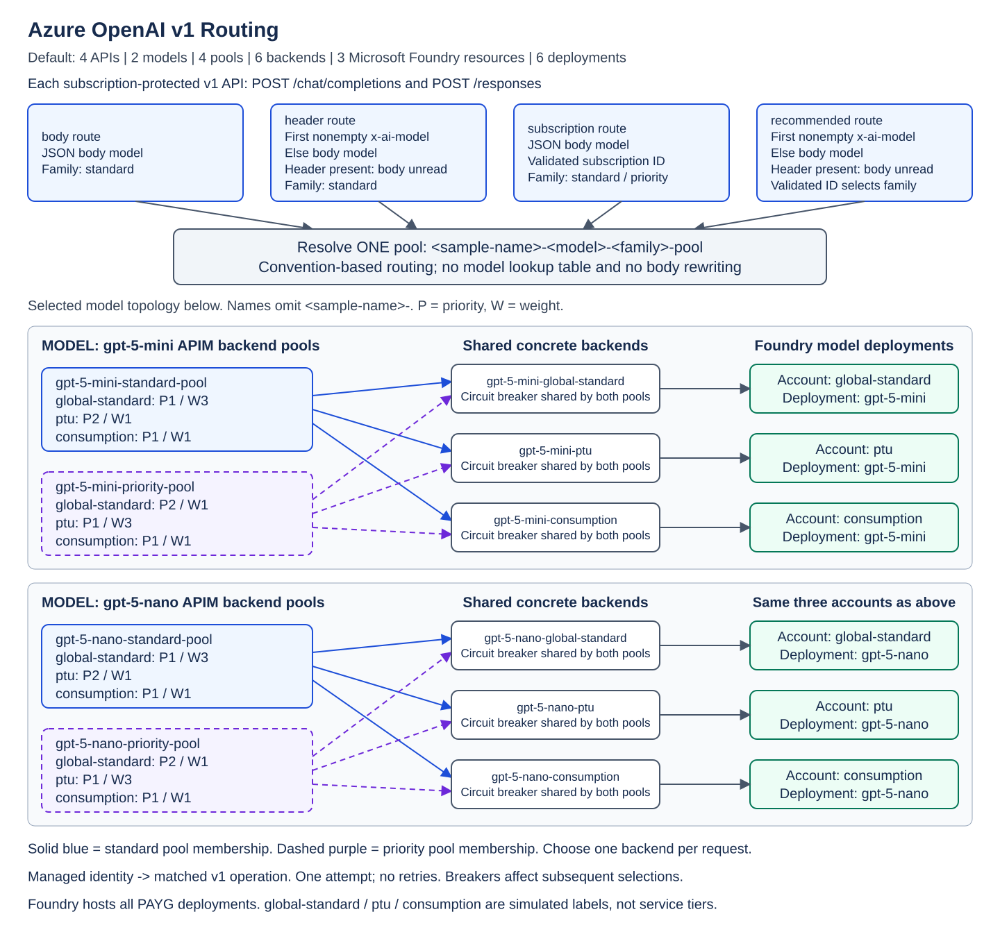

# Samples: Azure OpenAI v1 Routing

Route OpenAI v1 Chat Completions and Responses to models hosted in Microsoft Foundry through native APIM backend pools. Compare focused body, header and subscription policies with a recommended endpoint combining header-first selection and validated subscription priority, using shared circuit breakers and sanitized error telemetry. The AI Scenarios category describes sample content, not an APIM SKU; this sample does not require the AI Gateway SKU.

⚙️ **Supported infrastructures**: All infrastructures (`simple-apim`, `apim-aca`, `appgw-apim`, `appgw-apim-pe`, `afd-apim-pe`).

**Category**: AI Scenarios

👟 **Expected _Run All_ runtime (excl. infrastructure prerequisite): ~25-40 minutes**, including load-test cooldowns, subject to quota and managed identity propagation. Smoke-only runs take ~15-25 minutes.

## 🎯 Objectives

1. Construct model-specific pool identifiers by convention without a model-to-pool lookup table.
1. Route both v1 Chat Completions and Responses without translating their request or success-response formats.
1. Route a header-first request without inspecting or changing its body, including its streaming flag.
1. Compare standard and priority pool families using validated APIM subscription IDs, then combine priority with header-first selection.
1. Reuse concrete backend entities so circuit breaker state is shared across families.
1. Verify actual upstream error identities and correlate sanitized failures in Application Insights.
1. Apply bounded real Foundry load testing to demonstrate preferred-tier exhaustion, successful fallback, full-pool exhaustion and recovery on both v1 operations.

## ✅ Prerequisites

Start with the [repository prerequisites](../../README.md#prerequisites), plus:

- A supported infrastructure with system-assigned APIM identity and its normal `apim-logger` Application Insights logger. If the configured infrastructure is missing, `NotebookHelper.deploy_sample()` creates it or offers infrastructure creation/selection through the shared workflow.
- Permission to create Microsoft Foundry resources/model deployments and assign the Cognitive Services OpenAI User role to APIM on each account.
- Azure OpenAI access, model availability and PAYG quota in your chosen region for **three accounts**, each containing every selected model. Defaults are `gpt-5-mini` and `gpt-5-nano`, each at capacity 10. Capacity-to-TPM conversion depends on the model.
- Gateway egress to the Foundry resources' OpenAI-compatible endpoints and Microsoft Entra ID. Private gateway ingress does not imply private Foundry egress.
- A gateway/tier supporting native backend pools and circuit breakers. All five repository architectures are supported; this is not a claim that the **APIM Consumption SKU** supports these features.

No provisioned throughput is purchased. Account SKU is `S0`; model deployment SKUs are restricted to `GlobalStandard` or `Standard` PAYG. Names `global-standard`, `ptu` and `consumption` are **simulated semantic tier labels only**. All three destinations are real, distinct Microsoft Foundry resources (`Microsoft.CognitiveServices/accounts`, `kind: 'AIServices'`).

## 📝 Scenario

Four subscription-protected APIs each expose both operations under `/aoai-v1-routing-1/<scenario>/openai/v1`, with one focused API policy per scenario:

- `POST /chat/completions`, using the Chat Completions request and response contract.
- `POST /responses`, using the Responses request and response contract.

Both operations share the same scenario's subscriptions, backend pools and policy fragments:

- **body** ([body.xml](apim-policies/body.xml)) reads the JSON model deployment name and constructs `aoai-v1-routing-1-<model>-standard-pool`. It does not evaluate routing headers or priority entitlements.
- **header** ([header.xml](apim-policies/header.xml)) chooses the first nonempty `x-ai-model` header value and always uses the standard family. When present, the header bypasses **all body reads**, even validation or stream detection. Empty/whitespace header values fall back to body selection. An invalid nonempty header does not fall back.
- **subscription** ([subscription.xml](apim-policies/subscription.xml)) reads the body model and chooses the standard or priority family using only `context.Subscription.Id`. It does not evaluate routing headers.
- **recommended** ([recommended.xml](apim-policies/recommended.xml)) combines the same header-first selection/body fallback with the same validated subscription-based family selection. It has its own API-scoped standard and priority subscriptions; the subscription route's keys do not authorize this API.

The subscription-aware APIs each allow only their configured standard and priority subscription IDs. Other valid subscriptions, including all-APIs/admin subscriptions, do not gain access by display name or caller headers. The two header-first APIs never rewrite the body model: it must name a deployment available on the selected upstream, and mismatches remain the caller's responsibility. The recommended endpoint combines the sample's routing techniques; it does not add per-model authorization or replace production identity-based access controls.

Every model has the **same deployment name on every account**, equal to its model selector. Pool names are constructed by convention, with syntax/length validation but **no model membership set or model-to-pool lookup**. Adding/removing model records changes resources through data, without Python/XML model-specific branches or routing lookups. A syntactically valid unknown selector reaches native route resolution just like a configured selector.

Routing uses the matched APIM operation's `UrlTemplate`, so `/responses` is forwarded to `/openai/v1/responses`, not `/chat/completions`. Unmatched query parameters are dropped on both pathways, preserving the existing v1 forwarding behavior. Request bodies are preserved: Chat Completions uses `messages`; Responses can use string or array `input`. The backend owns operation-specific schema validation.

This sample exposes the two **POST creation operations**, not the full Responses resource lifecycle. Native pool selection provides no account affinity for `previous_response_id` or stored-response retrieval. Responses probes therefore send `store: false` and provide their input directly. For multi-turn usage, send client-held conversation context in `input`; account-affine server-side state requires a separate routing design.

The standard family uses priorities `[1, 2, 1]` and weights `[3, 1, 1]` for global-standard/ptu/consumption labels. The priority family uses priorities `[2, 1, 1]` and weights `[1, 3, 1]`. Lower numeric priority is preferred; weights matter **within the eligible priority group**. Thus standard favors global-standard over consumption, with ptu as fallback; priority favors ptu over consumption, with global-standard as fallback. No tiny probe set proves the statistical distribution.

### Choosing an Implementation

For a gateway needing both flexible model selection and caller-based service tiers, the default preference order is **recommended > subscription > header > body**:

1. **`recommended` - preferred combined implementation.** Use header-first model selection with body fallback and validated subscription-based standard/priority routing. A nonempty header avoids reading the body; callers without the header can still use the native v1 `model` field.
1. **`subscription` - preferred when service tiers matter but header selection does not.** Keep model selection in the native body and grant priority only through the configured, validated subscription ID. This is simpler than the combined policy when clients do not need a routing header.
1. **`header` - preferred when header selection matters but service tiers do not.** Route without reading the body when `x-ai-model` is nonempty, with body fallback otherwise. All callers use the standard family.
1. **`body` - simplest baseline.** Use only the native v1 `model` field and standard family. Choose this over the more capable policies when neither header selection nor subscription-based priority is needed.

This is a feature-fit guide, not a security or measured-performance ranking. **`subscription` and `header` solve different requirements**: prefer `header` over `subscription` when body-read avoidance matters more than service tiers. Header-first routing never rewrites or checks the body's model when a header is present; the caller must keep it compatible with the selected upstream.

All four implementations share the same backends, circuit breakers, managed-identity authentication, sanitized errors and unbuffered, single-attempt forwarding. The combined implementation does not add retries, Responses account affinity or per-model authorization. Layer production identity-based access controls onto whichever implementation you choose.

**Learning order is different from preference order:** the notebook introduces **body -> header -> subscription -> recommended** to explain each technique before combining them. Keep running its sections in their existing order; these are alternative API policies, not sequential routing stages.

### Policy Composition

Endpoint policies show only applicable choices. There are no runtime scenario switches: `scenario` is a fixed telemetry label, set after inherited inbound policies and reset in each endpoint's error section so inherited failures retain the correct label. Deployment selects the policy file; a request never selects a scenario branch inside a shared policy.

The sample-local [fragments](apim-policies/fragments/) share these mechanics:

| Fragment                                                                   | Responsibility                                                               |
| -------------------------------------------------------------------------- | ---------------------------------------------------------------------------- |
| [body-model.xml](apim-policies/fragments/body-model.xml)                   | Validate common v1 fields in a preserved body; select its model.             |
| [header-model.xml](apim-policies/fragments/header-model.xml)               | Read the first nonempty header without touching the body.                    |
| [subscription-family.xml](apim-policies/fragments/subscription-family.xml) | Select the family using the endpoint's configured subscription IDs.          |
| [route-request.xml](apim-policies/fragments/route-request.xml)             | Resolve the model pool, preserve the matched operation and authenticate.     |
| [safe-response.xml](apim-policies/fragments/safe-response.xml)             | Add correlation/pool evidence and sanitize upstream errors.                  |
| [safe-error.xml](apim-policies/fragments/safe-error.xml)                   | Classify scoped resolver/connectivity failures and trace bounded reasons.    |

Endpoints initialize `errorCode`, `errorStatus` and `family`; subscription-aware endpoints also supply fixed standard/priority IDs. Model selection sets `model`; shared routing validates it before resolving a pool. Fragments, pools and subscriptions use the fixed `aoai-v1-routing-1` prefix, with literal resource references in the XML. Bicep deploys the XML unchanged and creates fragments through the existing shared module before their API references. No fragment includes another fragment, which APIM does not support. Header/body fallback remains visible in the two endpoint policies where it applies.

The shared modules deploy policies and fragments with APIM's `rawxml` format, so expressions use readable C# such as `As<JObject>()`, `&&` and `>=` rather than XML entities. These are native APIM policy documents, not strict XML for a general-purpose XML validator. Structural tests encode expression attributes only in memory; deployment loads the source files unchanged. See Microsoft's [policy output-format guidance](https://github.com/Azure/azure-api-management-policy-toolkit/blob/main/docs/OutputFormat.md).

## 🛩️ Lab Components

The visual shows the default two-model configuration: **four APIs, four pools, six concrete backends and six model deployments across three accounts**. The recommended API reuses the same pools, backends and deployments; no additional model capacity is purchased. Each model lane repeats the same three accounts for readability; it does not represent additional accounts. Solid and dashed pool connections distinguish standard and priority membership, not separate request attempts.

Read each path from **route -> selected model and family -> pool -> concrete backend -> model deployment**. Pool member labels use `P` for priority and `W` for weight: lower `P` wins, and `W` applies only within the eligible priority group. Both families share each concrete backend's circuit breaker. The header route selects the pool but does not rewrite the body's model; the caller must keep it compatible with the selected account.

The editable [Draw.io source](../../assets/diagrams/Azure-OpenAI-v1-Routing.drawio) accompanies the SVG. Names omit the common `aoai-v1-routing-1-` prefix for space; deployment names are the model selectors without that prefix.

Each notebook section opens with a one-sentence recap of the current state and next step, followed by its purpose and expected outcome. This written walkthrough covers configuration, deployment, successful routing, local rejections, upstream rejections and telemetry without inline section diagrams; the full topology above remains an optional reference.

- Three Microsoft Foundry resources with system-assigned identities, project management enabled, identical PAYG model deployment lists, and APIM managed-identity RBAC. Local API-key authentication is disabled.
- One concrete backend per account/model, shared by both pool families and all four APIs. Breakers trip on 429/500-504; deployment mismatch 404 does not trip them.
- Two native, three-member pools per model, with distinct real account endpoints.
- Four APIs with two POST operations each, created with the shared API module and six sample-local policy fragments, preserving subscription authentication and inherited inbound policies.
- Sample-owned API diagnostics referencing the existing logger at **verbose** level, 100% sampling and `allErrors`, with header/body capture disabled. No LLM content logging is enabled.

The backend policy sends **one attempt, with no retries**, for every scenario. This avoids replaying header-first streaming requests whose stream state is intentionally unknown and avoids duplicate generation/billing for POSTs. Breakers affect subsequent native pool selections; this sample does not promise immediate retry/failover. `forward-request` has a 60-second timeout and unbuffered responses.

If a selected backend does not respond within that limit, the policy returns 504 `UpstreamTimeout`, not a generic 500 or a missing-model 404. Cell 7 includes the sanitized `ProbeResult` in a failed assertion, including its error code and request ID. Use that ID to inspect `LastErrorReason`, `LastErrorSource`, `LastErrorSection`, `BackendId` and `BackendTime` in gateway diagnostics; no prompts or keys are needed. A provisioned model does not guarantee every inference completes within the timeout. The sample deliberately fails instead of silently retrying or increasing the timeout.

Body-read paths parse, validate and select the model in one C# block with one preserved request-body deserialization. Only a compact `bodySelection` result containing the model, error code and error status is retained in context; the full parsed payload stays local to the block. Short policy assignments expose the result without reading or casting the payload again. Header-present paths do not parse the body. Common validation requires a JSON object, a string model selector and a boolean stream if present. Missing/null models return local 404 `ModelNotAvailable`; non-string models return local 400 `InvalidRequest`. Unlike the earlier Chat Completions-only version, the fragment does not require `messages` or validate `input`: operation-specific payload errors now reach authoritative upstream validation and retain the upstream HTTP status with a sanitized error body.

Both pathways retain unbuffered forwarding and leave successful response bodies unchanged, including streaming responses. The notebook probes validate non-streaming text results; they do not prove live SSE behavior.

### Foundry Hosting and Existing Deployments

[foundry-account.bicep](foundry-account.bicep) creates Foundry resources with `kind: 'AIServices'` and `allowProjectManagement: true`. This inference-only sample does not create projects, hubs, agents or evaluation resources. Model deployments remain account-scoped, use the `OpenAI` model format, and retain their existing selectors and PAYG SKUs.

APIM uses each resource's published OpenAI inference endpoint and appends `/openai/v1`; it does not send requests to a project endpoint or assume that the generic multi-service endpoint supports the same route. The endpoint metadata key contains the word `Legacy`, but the sample calls the current OpenAI v1 API. APIM's managed identity retains the account-scoped **Cognitive Services OpenAI User** role, which permits OpenAI inference without granting broader Foundry capabilities.

For an existing deployment of this sample, the deterministic `oai-r-...` account names, custom subdomains, nested deployment names and role-assignment IDs are preserved. Re-running deployment targets the same accounts for an [in-place upgrade to Foundry](https://learn.microsoft.com/azure/foundry/how-to/upgrade-azure-openai), rather than creating duplicate model capacity. Review organizational policies and regional Foundry support first. If you added private endpoints yourself, follow the upgrade guide's DNS/private-endpoint requirements before redeploying. This change does not perform a live upgrade automatically.

## ⚙️ Configuration

1. Open [create.ipynb](create.ipynb) and select the desired infrastructure, index and APIM SKU.
1. Set the region, model list, capacity and PAYG deployment SKU in **USER CONFIGURATION**. The sample prefix is fixed at `aoai-v1-routing-1`, so each APIM instance hosts one instance of this sample; choose a different infrastructure index for a separate deployment.
1. Run initialization, deployment, success probes, rejection probes, load tests, charts and reporting in order. The deployment cell reuses the configured infrastructure when available. Otherwise, the helper creates it when no supported instances exist, or offers to create it or select another supported instance.
1. Keep `model_capacity` deliberately small for load testing. Its default remains 10 to support the preceding smoke probes; conversion to TPM/RPM depends on the selected model and SKU. A value of 1 can make ordinary smoke probes throttle or exceed their token budget. Set `run_capacity_tests = False` for an explicitly smoke-only run.
1. Do not print deployment outputs or commit generated parameter/output files: shared deployment conventions retain subscription keys locally.

The notebook keeps scenarios, expected outcomes and assertions visible. [routing_helpers.py](routing_helpers.py) owns validated model projection, secret selection and single-request result normalization, composing the existing `ApimRequests` client. Its injected client factory owns cleanup on success and failures. Deployment uses `NotebookHelper`; no parallel Azure command/deployment framework is added.

With the default two models, smoke verification sends 68 requests: 32 success probes, 28 local rejection and fallback probes, and eight upstream-error probes. Both v1 operations still test success and missing-pool resolution on every API. Shared body validation runs once per operation through the body API, and upstream rejection runs on the first model through both header-first APIs. The success probes still cover every configured model, and each header-first API still demonstrates empty-header fallback.

### Load Testing, Quota Exhaustion and Recovery

The load-testing section uses the existing Foundry deployments, not MockAPI or simulated 429 responses. It adds no services or model capacity and does not change deployment SKUs, quota allocations or the existing single-attempt gateway policies. It sends **new billable requests**, not automatic retries of failed inference. The first configured model is tested through the recommended API using both Chat Completions and Responses, with standard and priority subscriptions: four isolated cases. Existing `run_capacity_tests` and `pressure_max_*` configuration names remain compatible.

Each case:

1. The first case waits 65 seconds for the shared one-minute breakers and typical quota windows. Later cases wait for the remaining conservative cooldown from the preceding case. Every case still requires a valid completion from a preferred member as its baseline. A broken or already-throttled baseline stops traffic.
1. Sends repeated-context prompts requesting a short greeting **sequentially**, using one session. Each request starts only after the preceding response finishes. `load_context_repetitions` defaults to 1000, five times the earlier input, to consume more input quota per request rather than sending many small requests. It stops starting requests at `pressure_max_requests` (default 20), `pressure_max_seconds` (default 90), or observed pool exhaustion. The request budget is a limit, not a target. The final load-test request finishes before recovery or cleanup; it can finish after the scheduling deadline, and each gateway backend attempt remains limited to 60 seconds. Serial model latency can allow quota to replenish before full exhaustion, but the evidence requirements are unchanged.
1. Requires actual 429s from **both** preferred members, followed by a successful completion on the fallback member while the observed preferred breaker windows remain active.
1. Requires 429s from all three distinct members, followed by a 503 while their observed breaker windows overlap. Both fallback and terminal exhaustion must come from requests sent after the relevant 429 observations. A later successful selection invalidates the member's earlier throttle evidence. A lone 503, transport timeout, client error or arbitrary gateway failure is not proof of pool exhaustion.
1. After load testing finishes, finds the latest observed 429 deadline for each preferred backend and waits until five seconds after the earliest of those deadlines, or proceeds immediately if that deadline plus its margin has passed. The small margin reduces sensitivity to approximate quota reset timing; a previous single recovery probe returned 429 with one second remaining despite the former one-second margin. Later 429s can extend the same backend's deadline. A 429 without a positive `Retry-After` uses the configured 60-second breaker duration; if no preferred backend returned 429, the helper waits 65 seconds as a conservative fallback. A recovery wait exceeding 180 seconds fails explicitly. Exactly one recovery probe must then return a completed result from a preferred member. These observed deadlines and the margin do not guarantee that the backend or quota has recovered, so a failed probe is reported rather than retried.

Before the next case, the notebook separately waits for the remaining conservative cooldown from all preceding load-test responses: at least 60 seconds or the reported `Retry-After`, whichever is longer, plus five seconds. This protects the next case's shared backends without delaying the single recovery probe. An additional isolation wait over 180 seconds fails explicitly.

For **standard**, `global-standard` and `consumption` share preferred priority 1, with `ptu` at fallback priority 2. For **priority**, `ptu` and `consumption` share preferred priority 1, with `global-standard` at fallback priority 2. This tests each existing family's real priority semantics, not an invented strict three-stage chain. It does not assert an exact weighted distribution.

The breaker is configured to trip on one 429, with a one-minute default trip duration and `acceptRetryAfter: true`. This does not replay the failed request: each gateway request makes only one backend attempt. The sequential pressure test does not overlap its own requests. However, [APIM gateway instances do not synchronize breaker state](https://learn.microsoft.com/azure/api-management/backends#circuit-breaker), so a later request can still reach the same throttled backend through another gateway instance. Repeated 429s do not imply that a four-failure threshold was configured. The fallback becomes eligible only when both preferred members are unavailable to the selecting gateway.

The outbound policy adds `x-routing-backend-host`, containing only the resolved request hostname, with no URL path, credentials or body. The helper matches this against the exact published inference origins in `accountOutputs` before attributing a 200 or 429 to a semantic tier. A pool-generated failure may have no resolved account; its hostname is not treated as proof of an upstream call. `x-routing-pool` identifies the requested pool, not its selected member.

All cases share the first model's actual account quota and gateway-local breaker state. Run without other traffic. Natural Azure throttling is timing-dependent: a bounded test that does not observe every required transition fails with **not demonstrated**, never a success-shaped fallback. Inspect the correlated evidence, regional quota and model-specific capacity conversion before adjusting budgets. Very low capacity or oversized input can reject the load-test prompt immediately on every tier, demonstrating exhaustion but not successful fallback; reduce `load_context_repetitions` if a fresh fallback cannot complete. Oversized capacity or small input can prevent throttling entirely; increase input repetitions cautiously rather than extending a long run that lets earlier backends recover. The larger default input aims to exhaust all three members within overlapping retry windows, but live acceptance still requires a rerun.

The helper defaults to sequential load testing, and the notebook explicitly enforces one request at a time. One owned `ApimRequests` session is reused for baseline, load testing and recovery, and closes on success or failure. The helper retains explicit concurrency support for offline comparisons, with one owned session per worker. It injects its clock, sleep and remote client boundaries for offline tests and retains only sanitized probe evidence. The summary includes load-test request count, elapsed time and a stop reason (`request-limit`, `time-limit` or `exhausted`), so partial coverage is not mistaken for broken failover. All traffic and recovery run before the final report and manual telemetry queries; waits isolate shared breaker state rather than repeatedly waiting for telemetry ingestion. With defaults, the four cases start at most 80 load-test requests plus eight baseline/recovery requests, in addition to the 68 smoke probes. Fewer requests with larger inputs do not guarantee lower token cost.

The notebook plots each case's warm-up (the healthy baseline probe), load-test responses and recovery. A light background band marks warm-up in both panels. The upper panel shows measured client response times, and the lower panel uses labeled account rows and distinct HTTP status markers to show routing and throttling without relying on color. The legend below the lower panel identifies the status markers and any reported retry windows. Each account label includes its role, priority and weight from the sample template, not a live configuration query. Lower priority wins, and weight applies within the eligible priority group. Preferred labels are green and fallback labels amber; standard-family titles are blue and priority-family titles purple. A short description at the bottom of each of the four charts identifies the operation, model, family, preferred/fallback members and the load-testing experiment's goal. The `No backend identified` row includes 503s because a pool can generate them without calling an account; the row does not prove whether a backend was called. Each chart shows load-test statistics and recovery wait before stating whether fallback, exhaustion and preferred recovery were demonstrated. Responses are shown in observation order; new runs are sequential, but marker order alone does not establish actual breaker state.

The chart settings in [routing_helpers.py](routing_helpers.py) mirror the fixed pool configurations in [main.bicep](main.bicep). If you change those configurations, update the chart settings and run the routing helper tests to check that they agree.

The chart cell uses recorded evidence and makes no Azure calls. If a case fails a gate, its chart is displayed before the assertion, and the chart cell can be run manually to revisit recorded cases. A skipped load test produces no load-test charts. Runs made before response times were retained can still show routing and status, but their missing timing measurements are explicitly labeled.

New load-test runs retain monotonic response-observation timestamps. Both panels place responses at equal intervals in observation order, not on a linear time scale. The top x-axis labels warm-up, the first and last load-test requests, selected multiples of five where space permits, and recovery. The bottom x-axis repeats these request labels above the corresponding elapsed seconds since the first load-test response (`0.0s`), with short row labels at the left; warm-up has no elapsed-time label. The timestamps measure response observations, not when requests were sent. If no load response was recorded, elapsed values are omitted and any retry window shows its duration without inventing a time origin. Each attributed 429 with a positive `Retry-After` shades its reported window in the backend's row; its label gives the reported duration and the elapsed start and expiry, rounded to a tenth of a second. Window ends are interpolated between observations, so their visual length is not proportional to elapsed time. Overlapping windows are merged; their labels say `merged` and show the reported durations or range and the full interval, not a multiplied delay. `continues` means the window extends beyond the last observation. If a backend has too many separate windows to label clearly, the chart warns that labels may overlap. A `//` mark on both panels identifies a compressed gap of at least 20 seconds between the last load-test response and recovery; the summary gives that observed gap's duration.

These are **reported retry windows**, not measured gateway breaker-open intervals or guaranteed account downtime. New sequential runs start each request after the preceding response; different gateway instances can still have different breaker states. Older concurrent runs may include successful requests already in flight when a 429 was observed. The retained evidence does not identify gateway instances, so it cannot establish actual breaker state. Missing or zero `Retry-After` values do not invent a shaded interval. Older retained evidence without timestamps uses the same response-order axis but omits shading; rerendering cannot reconstruct elapsed times from response latency.

## 🔍 Results and Telemetry

Successful probes require the requested operation's actual result shape, the convention-selected pool and a request correlation ID. Chat Completions must contain assistant text in `choices`; Responses must be `completed` with assistant `output_text` content in its `output` array, allowing preceding reasoning items. Incomplete Responses and a Chat Completions result returned to a Responses request fail the gate. Generated text is not retained in `ProbeResult`.

Both configured models are exercised across both pathways on all four APIs. The subscription and recommended APIs use identical path/body pairs for their standard/priority comparisons; recommended also covers header-present, empty-header and absent-header paths. Rejection, fallback and upstream mismatch probes run against both operations.

The negative probes check error identities, safe messages and pool evidence, not just status:

- Unknown selectors/missing pools return 404, `model_not_available`, and **The specified model is not available for use** when the scoped resolver fails. Missing/invalid selectors are rejected locally with the same message (`ModelNotAvailable`).
- Malformed/non-object body-read requests, non-string models and non-boolean stream flags return 400, `InvalidRequest`.
- On both header-first APIs, a known header pool with a body naming a deployment absent on **all three accounts** must produce an actual upstream deployment-not-found error (404, `DeploymentNotFound` or `model_not_found`). The body is not rewritten. If Azure changes its error identity, the assertion fails rather than treating any 404 as success.
- A known header with a non-object JSON body reaches upstream validation rather than local `InvalidRequest` on both header-first APIs; this proves the bypass separately from successful requests.

The header fallback probes use an empty string, because the `requests` client rejects whitespace-only header values before sending them. The policy treats both forms as empty; no live claim is made for a whitespace-only header sent through that client.

Upstream failure statuses are preserved. Error bodies retain only allow-listed upstream codes and a fixed safe message; arbitrary upstream text is not forwarded. Every local early return traces **before** `return-response`; outbound HTTP errors and policy failures trace independently. Trace dimensions contain request ID, a fixed scenario, a fixed error category and status. Policy failures additionally retain the original machine-readable `LastError.Reason` only when it matches `^[A-Za-z][A-Za-z0-9]{0,63}$`, otherwise `Other`: no prompts, responses, keys, selectors or `LastError.Message` content.

Use [queries/routing-errors.kql](queries/routing-errors.kql) in Application Insights Logs, replacing `requestId` with `x-routing-request-id` from a probe. The query also joins request telemetry by `operation_Id` without projecting URLs or content. Workspace-native equivalents use `AppTraces`/`AppRequests` and their PascalCase columns. Allow time for ingestion before checking error trace coverage.

### Scoped Unavailable Route Classification and Runtime Gates

The official [error handling reference](https://learn.microsoft.com/azure/api-management/api-management-error-handling-policies) documents `BackendConnectionFailure` for upstream connection failures. Neither it nor the [set-backend-service reference](https://learn.microsoft.com/azure/api-management/set-backend-service-policy) documents an exact missing-backend/pool `LastError.Reason`. **Do not invent `BackendNotFound`, match localized message strings, or translate all gateway errors to missing model.**

The policy precomputes `backendPool` from the syntax-validated selector, fixed `aoai-v1-routing-1` prefix and validated subscription family, then validates the complete identifier's syntax and 80-character bound. Before the resolver, parsing and validation are already finished. The `set-backend-service` expression is only a typed read of that variable, not arbitrary evaluation.

The exact classifier is:

1. Documented `BackendConnectionFailure` and the live-observed native-pool reason `PoolIsInactive` take precedence and return 503 `UpstreamUnavailable`. An inactive pool has no eligible members; it is not a missing model route. The error trace retains the reason so connection failures and pool exhaustion remain distinguishable.
1. `LastError.Reason == "Timeout"` with `LastError.Section == "backend"` returns 504 `UpstreamTimeout` with a fixed safe message. Timeouts in other policy sections do not match this backend-only guard.
1. Otherwise, **all three** must match: `LastError.PolicyId == "resolve-model-pool"`, `LastError.Section == "inbound"`, and `routePhase == "resolve"`. That scoped route-resolution failure returns 404 `model_not_available` with **The specified model is not available for use**.
1. Other policy failures return 500 `GatewayError`. The phase changes to `resolved` immediately after the resolver and before rewriting, managed-identity authentication or forwarding. Those later failures cannot match the unavailable-route guard. No source-name or guessed missing-pool reason string is assumed.

If load testing previously stopped on 500 `GatewayError` with trace reason `PoolIsInactive`, re-run the deployment cell to update the shared error fragment, then re-run the load-testing cell. The helper accepts the resulting 503 without fabricated backend evidence, but still requires prior overlapping 429s from all three tiers to prove exhaustion. Other 500 errors remain fatal.

This means **the convention-derived route is unavailable**, not proof of an absent Azure model deployment. Actual upstream deployment-not-found responses are handled separately in outbound, preserving their status and safe upstream error identity. Neither a generic gateway failure nor an upstream/MI/auth error is converted to a model 404.

**Precise remaining runtime uncertainty:** the references document `PolicyId` attribution and dynamic backend identifiers, but not whether each gateway build reports a nonexistent native pool synchronously at `set-backend-service` with that ID/section, or defers rejection until forwarding. The former follows the implemented graceful 404 contract; a deferred failure or absent/mismatched attribution deliberately stays a non-404 gateway/connectivity error. The unknown-alias notebook probes assert the expected resolver behavior without deleting resources. A deleted configured pool uses the same resolution path, but its actual attribution still requires a disposable live-Azure acceptance check; never remove shared or existing-sample backends. No destructive probe runs in the notebook.

APIM rejects missing/invalid subscription keys and unmatched operations **before** API policies run. Those requests cannot execute a sample `trace` statement; use the existing logger's request/gateway diagnostics for that coverage. Similarly, inherited policies can short-circuit before sample instrumentation. A claim of sample-policy traces for literally every gateway error is therefore gated by the platform pipeline. Existing/global telemetry settings may capture additional data independently; audit them before sending sensitive traffic.

No live Azure deployment or runtime policy compilation was performed when authoring this sample. Offline XML checks and Bicep builds do not execute APIM expressions, prove quota/RBAC readiness, prove trace ingestion, or verify Azure's current v1 error shape. Notebook assertions are intentional live acceptance gates.

## 🧹 Clean Up

Model removal from an incremental Bicep deployment stops advertising the model but **does not delete** old deployments, backends or pools. Plan and remove those sample-owned resources explicitly to release quota. Do not use complete-mode deployment on the shared infrastructure resource group.

For full cleanup, use the `aoai-v1-routing-1` prefix to identify its APIs, subscriptions, fragments, pools and concrete backends; standard API subscriptions use the shared module's `api-aoai-v1-routing-1-` prefix. Remove APIs before their referenced fragments, and pools before their members. Delete the three account resource IDs in `accountOutputs` to release their model deployments and account-scoped role assignments. Delete only sample-owned resources, never the existing logger, monitoring workspace or APIM service. No automatic notebook cleanup is run against shared infrastructure.

## 🔗 Links

- [APIM backend pools and circuit breakers](https://learn.microsoft.com/azure/api-management/backends)
- [Reusable policy fragments and their limitations](https://learn.microsoft.com/azure/api-management/policy-fragments)
- [Trace policy and Application Insights integration](https://learn.microsoft.com/azure/api-management/trace-policy)
- [Azure OpenAI v1 API lifecycle](https://learn.microsoft.com/azure/ai-foundry/openai/api-version-lifecycle)
- [Azure OpenAI Responses API](https://learn.microsoft.com/azure/foundry/openai/how-to/responses)
- [Microsoft Foundry architecture and resource types](https://learn.microsoft.com/azure/foundry/concepts/architecture)
- [Foundry model deployment and inference endpoints](https://learn.microsoft.com/azure/foundry/foundry-models/how-to/create-model-deployments)
- [Comparable Azure OpenAI v1 Migration sample](../aoai-v1-migration/README.md)
